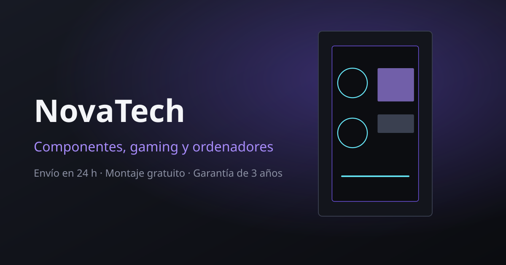

# Plantilla de tienda online — componentes, gaming y ordenadores

Plantilla de comercio electrónico hecha con **HTML, CSS y JavaScript**. Sin
frameworks, sin compiladores y sin plantillas: cada página es un archivo `.html`
que puedes abrir, leer y editar directamente.

> Puedes abrir `index.html` con doble clic y la tienda funciona: catálogo,
> filtros, buscador, carrito y pedido. El servidor de Node.js es **opcional**.



---

## Cómo usarla

**Opción 1 — sin instalar nada**

Abre `index.html` en el navegador. Ya está.

**Opción 2 — con el servidor incluido** (recomendada para ver la web como en producción)

```bash
npm install     # una sola dependencia: express
npm start       # abre http://localhost:3000
```

El servidor añade dos cosas: una página 404 de verdad y el guardado de los
pedidos, las suscripciones y los mensajes de contacto en `almacenamiento/`.

---

## Archivos

```
index.html            Portada
catalogo.html         Catálogo con filtros, orden y paginación
carrito.html          Carrito y datos de envío
gracias.html          Confirmación del pedido
contacto.html         Formulario de contacto con validación
404.html              Página de error
productos/            Una página por producto (19 de ejemplo)
css/estilos.css       Todos los estilos, comentados y por secciones
js/principal.js       Menú, carrito, acordeón, carrusel y boletín
js/catalogo.js        Filtros, orden y paginación del catálogo
js/carrito.js         Carrito y confirmación del pedido
js/recursos.js        Logotipo, banner, íconos y fondo dibujados con canvas
js/contacto.js        Validación y envío del formulario de contacto
img/                  Ilustraciones SVG de ejemplo
server.js             Servidor opcional (Express)
```

Como es HTML puro, **la cabecera y el pie están repetidos en cada archivo**.
Es lo normal en una plantilla: si cambias el menú, cámbialo en todas las páginas
(cualquier editor tiene "buscar y reemplazar en todos los archivos").

---

## Añadir o cambiar un producto

Un producto vive en dos sitios:

**1. Su tarjeta**, en `catalogo.html` (y en `index.html` si quieres que salga en
destacados). Copia un `<li>` entero y cambia los datos:

```html
<article class="producto" data-producto
         data-categoria="graficas" data-marca="Nytro"
         data-precio="549.9" data-valoracion="4.7"
         data-oferta="si" data-nombre="Nytro RX-7800 XT 16 GB">
```

Los `data-*` son los que usa el filtro:

| Atributo          | Para qué sirve                                      |
| ----------------- | --------------------------------------------------- |
| `data-categoria`  | Filtro de categoría (usa el mismo id que el menú).   |
| `data-marca`      | Filtro de marca.                                     |
| `data-precio`     | Filtro de precio y ordenación (con punto decimal).   |
| `data-valoracion` | Ordenar por "mejor valorados".                       |
| `data-oferta`     | `si` o `no`, para el filtro de ofertas.              |
| `data-nombre`     | Búsqueda y ordenación alfabética.                    |

Y el botón lleva lo que necesita el carrito:

```html
<button data-anadir data-slug="nytro-rx-7800-xt-16gb"
        data-nombre="Nytro RX-7800 XT 16 GB" data-precio="549.9"
        data-imagen="img/prod-grafica-1.svg" data-stock="12">
```

**2. Su página**, en `productos/`. Duplica un archivo, renómbralo con el mismo
`data-slug` (`productos/nytro-rx-9000-xt.html`) y cambia el texto.

> El precio aparece escrito ("549,90 €") **y** en `data-precio="549.9"`.
> Acuérdate de cambiar los dos.

### Otros cambios habituales

| Quiero…                            | Dónde se hace                                          |
| ---------------------------------- | ------------------------------------------------------ |
| Cambiar el nombre de la tienda     | Busca `NovaTech` y reemplaza en todos los archivos.     |
| Cambiar colores o tipografía       | Variables `:root` al principio de `css/estilos.css`.    |
| Cambiar los gastos de envío        | `CONFIG` al principio de `js/principal.js`.             |
| Cambiar la moneda o el idioma      | `CONFIG.moneda` y `CONFIG.local` en `js/principal.js`.  |
| Cambiar textos, FAQ o pie          | Directamente en el HTML de cada página.                 |

```js
/* js/principal.js */
const CONFIG = {
  moneda: 'EUR',
  local: 'es-ES',
  envioGratisDesde: 99,   // A partir de aquí el envío es gratis
  envioCoste: 4.95,
  maximoPorProducto: 10
};
```

```css
/* css/estilos.css */
:root {
  --fondo: #0b0c10;      /* fondo general */
  --acento: #a78bfa;     /* botones y enlaces */
  --cian: #67e8f9;       /* etiquetas "Nuevo" */
  --oferta: #ff7d97;     /* descuentos */
}
```

---

## Cómo funciona por dentro

**El catálogo** no tiene base de datos: los 19 productos están escritos en
`catalogo.html`. `js/catalogo.js` solo los muestra, los oculta y los reordena
según los `data-*` y lo que ponga en la dirección
(`catalogo.html?categoria=graficas&orden=precio-asc`), así que los filtros se
pueden compartir por enlace y se mantienen al recargar.

**El carrito** se guarda en el navegador (`localStorage`), así que sigue ahí al
cerrar la pestaña. Los botones "Añadir al carrito" llevan el nombre, el precio y
el stock en sus `data-*`, por eso no hace falta ningún archivo de datos.

**El pedido** se valida en `js/carrito.js`, se guarda en `sessionStorage` para
enseñarlo en `gracias.html` y, si el servidor está en marcha, también se envía a
`POST /api/pedido`, que lo escribe en `almacenamiento/pedidos.json`.

---

## Si la conviertes en una tienda de verdad

Esta plantilla calcula los precios en el navegador. Eso está bien para una
demostración, pero **no se puede cobrar así**: cualquiera puede cambiar un
`data-precio` desde el inspector. Antes de vender:

1. **Mueve el catálogo al servidor** (base de datos o un JSON en el backend) y
   recalcula ahí el total de cada pedido.
2. **Conecta una pasarela de pago** (Stripe, Redsys, PayPal…) en `/api/pedido`.
3. **Descuenta el stock** al confirmar el pedido.
4. **Envía el correo** de confirmación al cliente.
5. Sirve por HTTPS y añade el aviso de cookies y los textos legales.

El comentario que hay encima de `/api/pedido` en `server.js` marca el sitio exacto.

---

## Accesibilidad

Revisada con **axe-core (WCAG 2.2 AA): 0 incumplimientos** en las 8 páginas,
en escritorio (1280 px) y en móvil (390 px).

- Enlace "saltar al contenido" y estructura con `header`, `nav`, `main` y `footer`.
- Un solo `h1` por página y jerarquía de títulos correcta.
- Foco visible en todo; el menú móvil se cierra con `Escape`.
- El acordeón de preguntas usa `<details>`: funciona sin JavaScript.
- Todos los campos tienen etiqueta; los errores se asocian con
  `aria-describedby` y marcan `aria-invalid`.
- Los avisos ("Añadido al carrito") se anuncian con `role="status"`.
- Imágenes decorativas con `alt=""`; el resto, con texto alternativo.
- Se respeta `prefers-reduced-motion`.

---

## Notas

- Las imágenes de `img/` son ilustraciones SVG de ejemplo. Sustitúyelas por las
  fotos reales manteniendo el nombre del archivo.
- Las marcas y los productos son inventados: es una plantilla, no una tienda real.
- Sin JavaScript se ve toda la web y los 19 productos del catálogo; lo que deja de
  funcionar son los filtros y el carrito, que necesitan JavaScript por diseño.
- `almacenamiento/*.json` está en `.gitignore` porque contiene datos de personas.

## Licencia

MIT
